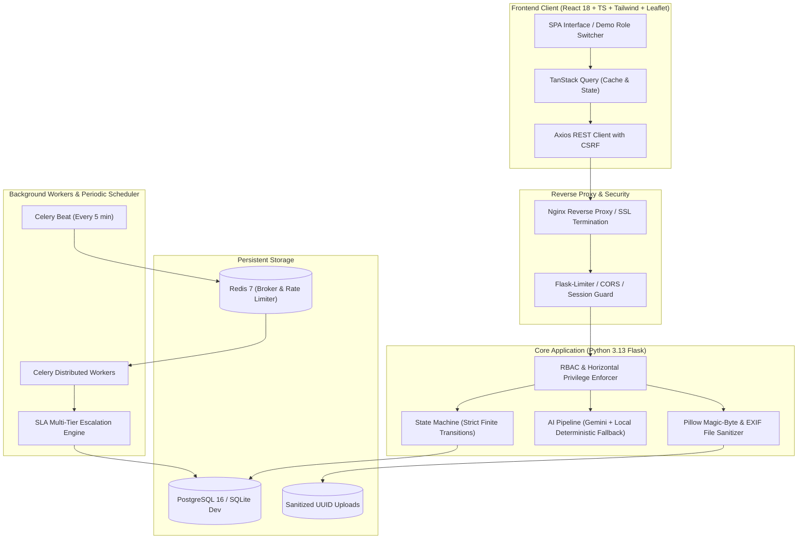

# 🏛️ CIVIC DISPATCH
### AI-Assisted Civic Grievance, Field Operations & SLA Escalation Platform

🌐 **Live Website:** https://civic-dispatch.vercel.app/

[](.github/workflows/ci.yml)
[](https://python.org)
[](https://react.dev)
[](https://www.typescriptlang.org/)
[](https://tailwindcss.com/)
[](https://www.postgresql.org/)
[](https://docs.celeryq.dev/)
[](https://redis.io/)
[](LICENSE)

---

## 📌 Executive Summary

**Civic Dispatch** is an enterprise-grade, placement-ready municipal governance and field operations platform designed to eliminate bureaucracy, prevent ticket stagnation, and restore public trust. 

Built with **React 18, TypeScript, Tailwind CSS, Leaflet, and Recharts** on the frontend, and **Python 3.13, Flask, SQLAlchemy, Celery, Redis, and PostgreSQL** on the backend, the platform features a strict finite state machine, a multi-tier SLA escalation engine, GPS proximity verification, and a resilient AI advisory pipeline with a 100% deterministic local fallback.

---

## ⚡ Recruiter & Evaluator Fast Track (1-Click Demo)

The web application includes a persistent **Demo Role Switcher Bar** pinned to the top of every screen. Evaluators can switch between all 4 municipal roles with zero manual typing:

| Role | Demo Email | Default Password | Key Capabilities to Inspect |
|:---|:---|:---|:---|
| **Citizen** | `citizen@civicdispatch.org` | `Password123!` | Intake Wizard, Live AI Category/Priority suggestions, Map Pin, Status Timeline, Citizen Satisfaction Rating |
| **Field Officer** | `officer@civicdispatch.org` | `Password123!` | Assigned Queue, GPS Proximity Verification, Start Work, Before/After Evidence Upload, Resolution Notes |
| **Department Manager** | `manager@civicdispatch.org` | `Password123!` | Operational Command Center, SLA Compliance Rates, Officer Workload, Recharts Trend Analytics, Ticket Reassignment |
| **System Administrator**| `admin@civicdispatch.org` | `Password123!` | System-wide Audit Logs, SLA Policy Management, CSV Data Export, Emergency Critical Overrides |

---

## 🏗️ System Architecture



---

## 🌟 Core Differentiators & Technical Highlights

### 1. Robust Finite State Machine (Zero Invalid Transitions)
Complaints progress through strictly validated server-enforced states:
`SUBMITTED` ➔ `ACKNOWLEDGED` ➔ `ASSIGNED` ➔ `IN_PROGRESS` ➔ `RESOLVED` ➔ `CLOSED`
- **Reopenings**: Permitted only within 7 days of resolution with a mandatory justification.
- **Rejections**: Permitted only with an authorized manager decision and audit log entry.
- **Append-Only History**: Every transition writes an immutable audit record to `complaint_status_history`.

### 2. Multi-Tier Background SLA Escalation Engine
A dedicated Celery background service continuously monitors resolution deadlines calculated dynamically per category and priority:
- 🟡 **Level 1 Warning (75% Elapsed)**: Notification dispatched to assigned officer.
- 🟠 **Level 2 SLA Breach (100% Elapsed)**: Severity escalated, department manager alerted.
- 🔴 **Level 3 Critical Escalation (125% Elapsed)**: Escalated to Municipal Administrator with high-priority flagging.

### 3. Geofenced Field Operations & GPS Verification
Field officers resolving issues submit their real-time device coordinates via browser Geolocation. The backend calculates the Haversine distance against the grievance pin:
- If distance is within the configurable tolerance (default: 250 meters), verification passes.
- If verification fails or is absent, an explicit legitimate exception reason must be logged.

### 4. Resilient Hybrid AI Pipeline
- **Smart Categorization & Priority Scoring**: Analyzes complaints for public safety keywords (e.g., *exposed high voltage wire*, *gas leak*, *sewer backflow*).
- **Duplicate Grievance Detection**: Computes geographical proximity (Haversine ≤ 150m) and Jaccard text similarity to flag duplicate tickets.
- **100% Deterministic Offline Fallback**: Does not crash if external AI APIs are unconfigured or throttled.

### 5. Bank-Grade Security & Horizontal Privilege Isolation
- **Role-Based Access Control**: Strict decorators (`@role_required`) enforce boundaries across all REST routes.
- **Anti-Tampering File Validation**: Uploaded attachments are inspected using Pillow magic-byte inspection (not just MIME extension spoofing), stripped of sensitive GPS EXIF metadata, and stored under cryptographically randomized UUID names.
- **Horizontal Privilege Isolation**: Citizens can only query their own complaints; field officers can only modify assigned tickets; department managers are scoped to their respective departments.

---

## 🚀 Quickstart Guide

### Option A: Local Development Setup (Windows / Linux / macOS)

#### Prerequisites
- **Python 3.13** (or 3.11+)
- **Node.js 20+** and **npm**
- (Optional for full background mode) **Redis 7**

#### 1. Backend Setup
```bash
# Clone the repository
git clone https://github.com/your-org/civic-dispatch.git
cd civic-dispatch/backend

# Create virtual environment
python -m venv .venv
source .venv/bin/activate  # On Windows: .venv\Scripts\activate

# Install dependencies
pip install -r requirements.txt

# Seed realistic demo database (creates civic_dispatch.db and demo accounts)
flask seed-db --reset

# Run backend test suite (15 unit & integration tests)
pytest -v

# Start backend API server (runs on port 5000)
python run.py
```

#### 2. Frontend Setup
```bash
# In a new terminal:
cd civic-dispatch/frontend

# Install dependencies
npm install

# Build production bundle (verifies TypeScript & Vite compiling)
npm run build

# Start development server
npm run dev
```
Open **`http://localhost:5173`** in your browser. Use the top **Role Switcher Bar** to explore any role instantly.

---

### Option B: Multi-Container Production Docker Setup

Run the full production stack with PostgreSQL, Redis, Flask Gunicorn, Celery Worker, Celery Beat, and Nginx SPA:

```bash
cd civic-dispatch

# Start all 6 orchestrated containers
docker-compose up --build -d

# Check running services
docker-compose ps
```

The application will be live at **`http://localhost`** (port 80 / port 3000).

---

## 🧪 Comprehensive Test Suite

The project includes thorough unit, integration, and security tests verifying state boundaries, SLA arithmetic, AI fallbacks, and horizontal isolation:

```bash
cd backend
pytest -v
```

### Verified Test Results:
```text
tests/test_auth.py::test_user_registration_and_login PASSED
tests/test_auth.py::test_login_invalid_credentials PASSED
tests/test_auth.py::test_unauthorized_access_protected_endpoint PASSED
tests/test_state_machine.py::test_valid_state_transitions PASSED
tests/test_state_machine.py::test_invalid_state_transition PASSED
tests/test_state_machine.py::test_reopen_within_policy_window PASSED
tests/test_sla.py::test_sla_calculation_hours PASSED
tests/test_sla.py::test_sla_engine_escalation_sweep PASSED
tests/test_ai_fallback.py::test_category_classification_fallback PASSED
tests/test_ai_fallback.py::test_priority_hazard_detection PASSED
tests/test_ai_fallback.py::test_duplicate_detection PASSED
tests/test_ai_fallback.py::test_executive_summarizer PASSED
tests/test_security.py::test_horizontal_privilege_isolation PASSED
tests/test_security.py::test_file_upload_validation PASSED
tests/test_security.py::test_audit_event_logging PASSED
============================== 15 passed in 2.82s ==============================
```

---

## 📊 REST API Specification Summary

All endpoints return standardized JSON structures with predictable HTTP status codes:

| Method | Endpoint | Access | Purpose |
|:---|:---|:---|:---|
| `POST` | `/api/v1/auth/register` | Public | Citizen account registration |
| `POST` | `/api/v1/auth/login` | Public | User authentication & session creation |
| `POST` | `/api/v1/auth/logout` | Authenticated | Terminate session & clear cookies |
| `GET` | `/api/v1/auth/me` | Authenticated | Retrieve current session profile & role |
| `POST` | `/api/v1/citizen/complaints` | Citizen | Submit new civic grievance |
| `GET` | `/api/v1/citizen/complaints` | Citizen | List authenticated citizen's grievances |
| `GET` | `/api/v1/citizen/complaints/:id`| Citizen / Staff | Get grievance details & timeline |
| `POST` | `/api/v1/citizen/complaints/:id/feedback`| Citizen | Submit 1-5 star resolution rating |
| `GET` | `/api/v1/officer/queue` | Officer | List complaints assigned to officer |
| `POST` | `/api/v1/officer/complaints/:id/start-work`| Officer | Transition ticket to `IN_PROGRESS` |
| `POST` | `/api/v1/officer/complaints/:id/resolve`| Officer | Resolve with GPS validation & evidence |
| `GET` | `/api/v1/manager/dashboard` | Manager / Admin| Departmental KPI metrics & trends |
| `POST` | `/api/v1/manager/complaints/:id/reassign`| Manager / Admin| Reassign ticket to another officer |
| `GET` | `/api/v1/admin/audit-logs` | Admin | Query system-wide immutable audit trail |
| `GET` | `/api/v1/admin/export/complaints`| Admin / Manager| Export filtered complaint dataset as CSV |
| `POST` | `/api/v1/ai/categorize` | Authenticated | Real-time category & priority estimation |
| `GET` | `/api/v1/public/stats` | Public | Public transparency aggregated statistics |

---

## 📁 Directory Structure

```text
civic-dispatch/
├── .github/
│   └── workflows/
│       └── ci.yml                     # Automated GitHub Actions CI workflow
├── backend/
│   ├── app/
│   │   ├── ai/                        # AI classification, priority & duplicate logic
│   │   ├── api/                       # Modular Flask blueprints for all roles
│   │   ├── models/                    # SQLAlchemy ORM models (Complaints, Users, SLAs)
│   │   ├── security/                  # RBAC decorators & Pillow file sanitizers
│   │   ├── seeds/                     # Synthetic municipal demo data seeder
│   │   ├── sla/                       # SLA calculation & multi-tier escalation engine
│   │   ├── state_machine/             # Finite state machine validator & history
│   │   └── tasks/                     # Celery background tasks & periodic scheduler
│   ├── tests/                         # Pytest test suite (15 unit/integration tests)
│   ├── config.py                      # Development, Production & Testing configurations
│   ├── requirements.txt               # Pinned Python package dependencies
│   ├── run.py                         # Application entrypoint & auto-seeder
│   └── Dockerfile                     # Production Python 3.13 slim container
├── frontend/
│   ├── src/
│   │   ├── components/                # Reusable UI (StatusBadge, GrievanceMap, Navbar)
│   │   ├── context/                   # AuthContext with 1-click demo role switching
│   │   ├── pages/                     # Dedicated views for all 4 roles + Public Home
│   │   ├── services/                  # Type-safe Axios API client
│   │   ├── types/                     # Comprehensive TypeScript domain interfaces
│   │   ├── App.tsx                    # React Router declarative route protection
│   │   ├── main.tsx                   # React root entrypoint
│   │   └── index.css                  # Tailwind directives & Leaflet styling
│   ├── nginx.conf                     # Production Nginx reverse proxy configuration
│   ├── Dockerfile                     # Multi-stage production frontend container
│   ├── package.json                   # Frontend dependencies & Vite scripts
│   └── tailwind.config.js             # Municipal slate & navy color system
├── docker-compose.yml                 # Multi-service production orchestration
├── .env.example                       # Environment configuration template
├── PROJECT_BRIEF.md                   # GSD specification & project architecture
├── TASKS.md                           # Verification milestones & task checklists
├── todo.md                            # Ralph loop execution status
└── README.md                          # Master documentation & evaluation manual
```

---

## ⚖️ License
This project is open-source software licensed under the [MIT License](LICENSE).

